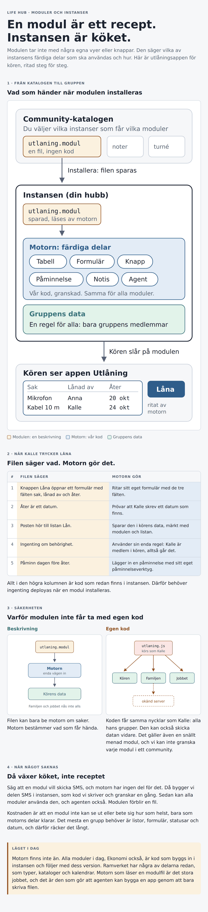

# Beslut 0005: moduler byggs som beskrivningar, och hämtas ur en katalog

Status: **beslutat** (2026-10-13). CP: "Jag är med på detta. VI håller det enkelt." och "Yes kör. Detta är ju kärnfunktioner."
Epik: cllp/lifehub.app#213. Ärenden: cllp/lifehub.app#210 (community-moduler), cllp/lifehub.app#211 (kunder med egen drift).
Relaterat: beslut 0003 (appar pluggar in i ytor via platser), `src/lib/modul.js` (manifestet är data), #92 (modulkontraktet).

Det här är ett designbeslut. Ingen kod i den här leveransen bygger motorn; epikens skivor gör det.

## Händelsen

CP 2026-10-13, efter ett möte med Rob på Udda, i tre inkorgsrader:

- "Om en instans behöver en ny modul från Communityt, så skall den kunna installera/hämta hem en modul så att den blir
  tillgänglig för grupper oavsett var instansen är installerad." (#210)
- "Om en kund vill köra en instans på eget cloud. Hur gör vi då? ... En hubadmin (kund) måste kunna pinna om instansen till
  ny framework. Och kunna gå och hämta nya community moduler." (#211)
- Och i samtalet efteråt: "Vad är säkerhetsrisken? Det är ju bara en datamodell som installeras ... Hur håller vi det enkelt att
  bygga eller installera nya appar?" och "Tänker bara hur det kan bli mer som Lovable, att man faktiskt bygger något som är
  customizable."

Frågan hade inget svar, eftersom varje modul i dag är kod som byggs in i instansen (Ekonomi i `lifehub.app`
`web/src/app/moduler.jsx`). Att installera betyder i dag ompinning och deploy. Att hämta en modul medan instansen kör
betyder något annat, och svaret avgör plattformens största säkerhetsfråga.

## Beslutet

⛔ **En community-modul är en beskrivning, inte kod.** Den säger vilka av motorns färdiga delar som ska användas och hur.
Motorn i instansen ritar vyerna, sparar datan och kör åtgärderna med sin egen, granskade kod.

Det är samma väg som `src/lib/modul.js` redan tar: "MANIFESTET ÄR DATA. BETEENDET REFERERAS UR DET." Skillnaden är att
beteendet en beskrivning pekar på alltid är motorns egna delar, aldrig appens kod.

### Skälet: kod får nycklarna, en beskrivning får bara be

- **Kod i webbläsaren körs som den inloggade personen.** Den kan läsa och skriva allt personen kan, i alla personens grupper,
  och skicka det vidare. Det gäller också en snällt menad modul.
- **Kod på servern går förbi reglerna.** Admin SDK når alla gruppers data och hemligheterna.
- **Egna Firestore-regler per modul är också kod.** En slarvig regel öppnar data för fel personer.
- **En beskrivning kan inget av det.** Den kan bara be motorn om saker, och motorn bestämmer vad som får hända.

### Tre byggsätt. En modul byggs på det enklaste som räcker

"Nivå" används redan i beslut 0003 om var en app pluggar in. Här är frågan hur den byggs, och ordet är därför byggsätt.

| Byggsätt | Vad | Granskning | När |
|---|---|---|---|
| **A. Beskrivning** | Listor, fält, tabell, formulär, kort, kalender, knappar med åtgärder ur en fast lista, påminnelser, agentverktyg | Ingen behövs: filen kan inte göra något motorn inte tillåter | Först. Den täcker det mesta en grupp behöver |
| **B. Kod i sandlåda** | Egna vyer och egen logik, när A inte räcker | Agenter granskar och CP godkänner, för communityt. En grupps egen modul körs i sandlådan utan granskning | Efter A |
| **C. Serverkod** | Egna bakgrundsjobb | Svårast att göra säkert | Senare, eget beslut |

**Sandlådan (B)** är två lager, och båda behövs. Granskningen fångar dålig avsikt och dålig kvalitet. Sandlådan begränsar
skadan när granskningen missar något. Koden körs på en egen adress, skild från hubben, och når gruppens data bara genom ett
smalt API i ramverket, med de behörigheter hub-admin godkände vid installationen. En agent som granskar kod kan luras, och
därför räcker inte granskningen ensam.

**När en del saknas** i motorn, till exempel att skicka SMS, byggs den i motorn en gång, som granskad kod. Sedan kan alla
moduler och agenten använda den. Det är samma princip som platserna i beslut 0003: saknas något öppnar ramverket det, en
gång, för alla.

### Motorn äger datan och regeln

⛔ **All moduldata ligger i ett generiskt hem med `groupId`, och en regel gäller för alla moduler: gruppens aktiva medlemmar.**
Ingen modul skriver egna regler. Samlingens namn skickar appen in, som alltid ("Ramverket känner aldrig projekt-id eller
samlingsnamn" i `CLAUDE.md`).

Kostnaden är att en modul inte kan ha en egen behörighetsmodell, till exempel att bara vissa medlemmar ser en lista. Det är
medvetet: läsregler som avgör synlighet är det SessionStudio kallar permissions-träsket (kanonens regel 13), och CP
2026-10-13: "VI skall för allt i världen inte kludda till det med permissions. Då tar jag hellre bort funktionalitet."

### Kopplingar

En modul kan använda gruppens kopplingar, till exempel banken. Modulen säger vilken koppling och vilken behörighet
("Bank: läsa konton"), och gruppens ägare godkänner när modulen slås på. Nyckeln ligger i Identity som i dag (AI-nyckeln,
kalendrarna), och anropen går genom hubbens server. Modulen ser aldrig nyckeln.

### Var det bor

| Del | Var | Vad |
|---|---|---|
| **Modulformatet och motorn** | `ops-framework` | Formatet, valideringen vid uppstart, delarna som ritar, och regelfragmentet för moduldata |
| **Källan till community-moduler** | Ett eget repo, `cllp/lifehub.moduler`, en mapp per modul | Filen, versionen och ändringsloggen, på B också koden. En PR är en inlämning, merge och tagg betyder publicerad |
| **Katalogen** | `lifehub.identity` | Vilka moduler som finns och vilka instanser som får vilka. Skrivs ur modulrepot vid merge: ett hem och en genererad kopia (kanonens regel 2) |
| **Hämtningen** | Instansen (`lifehub.app`) | Hub-admin trycker Hämta. Instansen frågar Identity med samma inloggning mellan servrar som kalendern, prövar version och kontrollsumma, och sparar filen i sin egen databas. Gruppens ägare slår på den |
| **En grupps egna moduler** | Bara i instansen | Agenten skriver filen i gruppen. Ska den delas öppnar agenten en PR mot modulrepot |

⛔ **Instansen hämtar ur Identity, aldrig direkt ur GitHub.** Varje instans litar redan på Identity. En kund med egen drift
(#211) hämtar då från samma ställe utan GitHub-nycklar, och CP styr tillgången på ett ställe.

⛔ **Uppdateringar väljs, de kommer aldrig av sig själva.** En ny version kan ändra datan. Hub-admin ser att en uppdatering
finns och väljer.

⛔ **Modulrepot skapas när den första community-modulen finns**, inte före. Ett tomt repo är ett ställe som ser ut att vara
på väg någonstans (kanonens regel 8, omvänt).

### Kärnappar och community-appar i samma katalog

CP 2026-10-13, med en skärmbild av Hubben där Ekonomi, Meddelanden och Bibliotek har var sin brytare: "Vi kan ha Chatt och
Bibliotek som inbyggda appar. Även Ekonomi. Men Ekonomi är en väldigt specifik app. Skall ju inte vara tillgänglig för alla."

- **Kärnappar** är kod och följer med instansens version: Meddelanden, Bibliotek och Ekonomi. De hämtas inte ur katalogen,
  men de står i samma lista som community-apparna och styrs med samma reglage. Hämta slår då bara på appen direkt.
- **Community-appar** är beskrivningar som hämtas på riktigt.
- För hub-admin ser båda likadana ut: en lista och ett reglage.

⛔ **De befintliga kärnapparna är inte det första provet av byggsätt A.** Meddelanden bär chatten, agenten och TALK. Ekonomi
har bankkoppling och serverjobb. Bibliotek har filer med egna regler. Att bygga om dem först hade krävt hela plattformen innan
det enkla fallet var bevisat, och riskerat funktioner som används varje dag. Bibliotek är kandidaten att flytta först, när
motorn har en fildel.

### Hub-admin väljer vilka grupper som får en app

CP 2026-10-13: "Om jag vill att ekonomi-modulen skall vara tillgänglig för min grupp och inte en annan grupp så går det inte
idag. Skall vi utöka hubadmin till att välja specifika grupper som kan installera appar. Alla eller valda grupper?" Och: "Då
kör vi på det."

Varje app i Hubben har tre lägen i stället för en brytare:

| Läge | Betyder |
|---|---|
| **Av** | Ingen grupp kan lägga till appen |
| **Alla grupper** | Varje grupp kan lägga till den (dagens läge) |
| **Valda grupper** | Bara grupperna hub-admin kryssat i |

- Gruppens ägare ser bara de appar gruppen får lägga till.
- ⛔ **En grupp som plockas bort ur listan får appen dold, inte raderad.** Datan står kvar, precis som när en grupp slår av en
  app i dag.
- En ny grupp får ingenting av sig själv när läget är Valda grupper.
- ⛔ **Servern prövar valet när en grupp slår på en app**, inte bara knappen. Det är en uppslagning mot hubbens inställning,
  inga läsregler per grupp.
- Samma reglage används när en community-app hämtas: hub-admin väljer Alla grupper eller Valda grupper direkt.

**Senare:** att en grupp kan efterfråga en app som den inte får lägga till. CP: "Men det kan vi ta senare."

## Det som inte bestäms här

- Modulformatets exakta fält. Det bestäms i första skivan, med utlåning som första exempel.
- Hur sandlådan byggs tekniskt (egen adress, ramverkets API mot den). Det är ett eget beslut innan B byggs.
- Betalning och licens för community-moduler.

## Följdsteg

Skivorna står i epiken cllp/lifehub.app#213. Förslaget till ordning:

0. **Hubben:** Av, Alla grupper eller Valda grupper per app, med serverns prövning. Kärnapparna i samma lista. Litet nog att
   byggas före motorn.
1. **Ramverket:** modulformat v1 och motorn för A: lista, tabell, formulär och knapp ur en beskrivning, regelfragmentet för
   moduldata och prov mot emulatorn. Utlåningen är exemplet.
2. **Instansen:** beskrivningar sparade i instansen och påslagna per grupp, i samma lista som appens moduler (`groups.moduler`).
3. **Agenten:** skriver en beskrivning i gruppen, med förhandsvisning, så att en app byggs genom att prata.
4. **Kopplingar:** behörigheter per modul, godkända av ägaren.
5. **Katalogen och hämtningen:** modulrepot, katalogen i Identity och knappen Hämta.
6. **Sandlådan (B):** eget beslut först.
